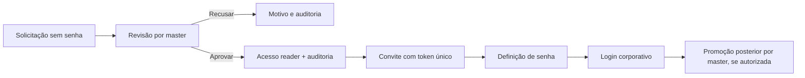

# Contract Guardian — especificação de integração do backend

**Entrega ao especialista · 29/10/2026 · proposta 1.0.0**

Este documento e [openapi.json](openapi.json) definem a API proposta para conectar o frontend existente. **Nenhum endpoint está implementado.** Esta entrega acrescenta documentação; não altera telas, funcionalidades ou o código de execução da aplicação. O backend pode usar a linguagem, o framework e o banco escolhidos pelo especialista.

O produto atende uma única empresa. `master` administra contratos e acessos; `reader` consulta e exporta contratos. Não existe cadastro livre com senha nem login social. A aprovação administrativa deve preceder a ativação de qualquer conta.

## 1. O que implementar

Base proposta: **`/api`**, preferencialmente na mesma origem do frontend. As rotas `#login`, `#contracts` etc. pertencem ao React e não são rotas HTTP da API.

Há **17 operações essenciais**, distribuídas em 12 caminhos. As duas operações de ativação completam uma jornada que ainda precisa de tela no frontend.

| # | Método e caminho completo | Quem pode usar | Responsabilidade |
|---|---|---|---|
| 1 | `GET /api/session` | Público | Restaurar a sessão real ou informar ausência de sessão; fornecer token CSRF. |
| 2 | `POST /api/session` | Público | Autenticar e-mail e senha de uma conta aprovada e com credencial ativada. |
| 3 | `DELETE /api/session` | Público/idempotente | Revogar a sessão atual e limpar seu cookie. |
| 4 | `POST /api/access-requests` | Público | Registrar solicitação de acesso, sem senha e sem escolher perfil. |
| 5 | `GET /api/access-requests` | Master | Listar e filtrar solicitações da empresa. |
| 6 | `POST /api/access-requests/{requestId}/review` | Master | Aprovar como reader ou recusar com motivo; registrar a decisão e sua autoria. |
| 7 | `GET /api/users` | Master | Listar usuários aprovados, perfis e situação da ativação. |
| 8 | `PATCH /api/users/{userId}/role` | Master | Alterar explicitamente reader/master e auditar. |
| 9 | `GET /api/audit` | Master | Consultar o histórico de aprovações, recusas e mudanças de perfil. |
| 10 | `GET /api/contracts` | Master e reader | Buscar, filtrar, ordenar e paginar contratos. |
| 11 | `GET /api/contracts/{contractId}` | Master e reader | Obter o registro completo e a versão atual para consulta/edição. |
| 12 | `POST /api/contracts` | Master | Criar contrato após a revisão humana do formulário. |
| 13 | `PATCH /api/contracts/{contractId}` | Master | Alterar contrato, verificando a versão para evitar sobrescrita concorrente. |
| 14 | `POST /api/contracts/analyze` | Master | Receber PDF/JPG/TXT e iniciar análise assíncrona. |
| 15 | `GET /api/document-analyses/{analysisId}` | Master | Consultar processamento e obter campos extraídos para revisão. |
| 16 | `POST /api/account-activations/validate` | Público, com token válido | Verificar convite de ativação sem consumi-lo. |
| 17 | `POST /api/account-activations` | Público, com token válido | Consumir convite e cadastrar a senha inicial. |

“Público” significa que a pessoa ainda não precisa estar autenticada no produto. Essas operações continuam sujeitas a validação, proteção CSRF e limites de tentativas. Não é uma autorização para criar uma conta ativa ou escolher uma empresa/perfil.

### Operações opcionais

Estas **8 operações não são necessárias para manter os cálculos locais atuais**, mas servem para recuperação de senha, volumes maiores ou sincronização de preferências. São marcadas como opcionais no OpenAPI.

| Método e caminho | Permissão | Quando usar |
|---|---|---|
| `POST /api/password-resets` | Público | Solicitar recuperação; exige fluxo e tela novos. |
| `POST /api/password-resets/confirm` | Público, token válido | Redefinir senha e revogar sessões; exige tela nova. |
| `GET /api/dashboard/summary` | Master e reader | Obter indicadores e vencimentos sem carregar toda a carteira. |
| `GET /api/reports/financial` | Master e reader | Obter a série financeira e distribuição por categoria no servidor. |
| `GET /api/contracts/export` | Master e reader | Exportar todos os registros correspondentes aos filtros, independentemente da página. |
| `GET /api/audit/export` | Master | Exportar todos os eventos correspondentes aos filtros. |
| `GET /api/me/preferences` | Master e reader | Carregar preferências pessoais entre dispositivos. |
| `PATCH /api/me/preferences` | Master e reader | Salvar preferências pessoais entre dispositivos. |

O calendário usa vencimentos de contratos; não precisa de endpoint próprio. Os avisos atuais são calculados na interface; não existe caixa de notificações persistida nem envio de alertas por e-mail/SMS. A aprovação, porém, precisará de entrega do convite de ativação por e-mail ou por um canal corporativo confiável.

## 2. Convenções da API

- JSON UTF-8, nomes em `camelCase`, IDs opacos fornecidos pelo servidor.
- Datas de vigência em `YYYY-MM-DD`, inclusivas, sem horário. `Contract.createdAt` também permanece uma data para compatibilidade com o modelo atual.
- Sessões, solicitações, auditoria e análises usam timestamps UTC em RFC 3339, por exemplo `2026-10-29T15:00:00Z`.
- O “hoje” de negócio usa `America/Sao_Paulo`. A API devolve `meta.referenceDate` nas listas; detalhe de contrato também informa essa data.
- Valores monetários no JSON são números em reais, sem `R$`, pontos de milhar ou vírgula decimal. Validar duas casas e armazenar/calcular com decimal exato no servidor, sem ponto flutuante para somas financeiras. O limite monetário máximo deve ser fechado com a empresa.
- CNPJ é texto, nunca número: preservar zeros à esquerda e aceitar o formato alfanumérico descrito na seção 6.
- Perfis: `reader | master`. Assinatura: `Assinado | Pendente | Em revisão`. Vigência: `Ativo | Pendente | Expirado`. Não confundir os dois últimos conceitos.
- O backend obtém empresa, identidade, perfil vigente, IDs gerados, responsáveis e horários a partir de dados confiáveis do servidor.
- Não aceitar `actor`, `approvedBy`, `reviewedBy`, `organizationId`, `createdAt` ou privilégios enviados pelo cliente para determinar autorização ou autoria. DTOs de escrita devem rejeitar propriedades fora da lista permitida.

### Respostas e paginação

Um item: `{ "data": { ... } }`. Listas:

```json
{
  "data": [],
  "meta": {
    "page": 1,
    "pageSize": 50,
    "total": 0,
    "totalPages": 0,
    "referenceDate": "2026-10-29"
  }
}
```

`page` começa em 1; `pageSize` tem padrão 50 e máximo 100. `total` conta o resultado dos filtros; uma página após o fim retorna lista vazia. Usar desempate estável por ID nas ordenações.

`GET /access-requests` acrescenta `meta.counts: {pending, approved, rejected}`; `GET /users` acrescenta `meta.counts: {active, masters}`. Esses contadores consideram toda a empresa, antes de busca/filtros, para alimentar os cards. A lista de usuários inclui o master inicial provisionado por administração.

**A interface atual não tem paginação.** Na integração inicial, o adaptador precisa carregar todas as páginas necessárias antes de calcular totais, gráficos e exportações. Calcular um dashboard com somente 50 registros alteraria os números. Para volumes maiores, conectar os agregados/exportações opcionais e a navegação entre páginas. Uma lista filtrada do calendário não deve substituir a carteira completa na store global.

### Erros

```json
{
  "error": {
    "code": "VALIDATION_ERROR",
    "message": "Revise os campos informados.",
    "field": "provider.email",
    "details": [
      { "field": "provider.email", "message": "Informe um e-mail válido." }
    ],
    "requestId": "identificador-de-rastreamento"
  }
}
```

`field` e `details` são opcionais. Não devolver stack traces, senhas, tokens ou texto integral do documento em erros.

| HTTP | Uso |
|---|---|
| 400 | JSON, query ou parâmetros malformados. |
| 401 | Sessão ausente/expirada ou login inválido, com mensagem genérica no login. |
| 403 | Perfil insuficiente ou proteção CSRF inválida. |
| 404 | Registro ausente ou fora do escopo autorizado da empresa. |
| 409 | Conflito: duplicidade, revisão já concluída, versão antiga ou mudança de perfil impedida. |
| 413 | Arquivo maior que 10.485.760 bytes. |
| 415 | Tipo/conteúdo de arquivo não permitido. |
| 422 | Campos bem formados, porém inválidos segundo as regras de negócio; token inválido/expirado/usado. |
| 429 | Limite de tentativas; informar `Retry-After`. |
| 500 / 503 | Falha interna ou indisponibilidade, sem revelar detalhes internos. |

## 3. Sessão e permissões

### Bootstrap, login e saída

1. Ao abrir o produto, `GET /api/session` retorna 200 com `{data:{user:null,csrfToken:"..."}}` para visitante ou `user` preenchido para sessão válida. Pode estabelecer uma sessão anônima para vincular o token CSRF.
2. `POST /api/session` recebe apenas `{email,password}` e o header `X-CSRF-Token`. Normalizar o e-mail. Não modificar a senha digitada com trim ou conversão de caixa.
3. Exigir aprovação, acesso ativo e credencial já ativada. Falha retorna `401 INVALID_CREDENTIALS` sem distinguir usuário inexistente, senha errada ou conta indisponível.
4. Sucesso retorna `{data:{user:{id,name,email,role,organizationId},csrfToken}}`. Renovar o identificador da sessão e o token CSRF.
5. `DELETE /api/session` revoga a sessão e limpa o cookie. Retorna 204, inclusive se já não houver sessão autenticada. Ainda exige a proteção de origem/CSRF definida para o produto.

A sessão real **não contém `isPreview:true`**. Personas `preview-master` e `preview-reader`, dados de armazenamento local e o método `startPreview` nunca autenticam chamadas ao backend.

Proposta de transporte: cookie `__Host-guardian_session`, `HttpOnly`, `Secure`, `Path=/`, sem `Domain`, com `SameSite=Lax` para a implantação na mesma origem. Todo POST/PATCH/DELETE usa `X-CSRF-Token`; o servidor valida sua vinculação e a origem. Rotas de sessão e dados privados usam `Cache-Control: no-store`. Expiração, revogação e renovação são controladas pelo servidor. Estas medidas seguem a orientação de [gestão de sessões da OWASP](https://cheatsheetseries.owasp.org/cheatsheets/Session_Management_Cheat_Sheet.html).

Se a API estiver em outra origem, o especialista deve alinhar URL-base, CORS com origem explícita, credenciais e cookies com a hospedagem; `/api` não passa a existir no Site estático automaticamente.

### Matriz de autorização

| Ação | Visitante | Reader | Master |
|---|---|---|---|
| Solicitar acesso / ativar credencial com token | Sim | Não precisa | Não precisa |
| Consultar contratos, dashboard, calendário e relatórios | Não | Sim | Sim |
| Exportar contratos e relatórios existentes | Não | Sim | Sim |
| Cadastrar, editar ou analisar contrato | Não | Não | Sim |
| Consultar solicitações, usuários e auditoria | Não | Não | Sim |
| Aprovar/recusar e alterar perfis | Não | Não | Sim |
| Escolher o próprio perfil durante solicitação/ativação | Não | Não | Não |

Revalidar o perfil vigente a cada operação. Uma sessão antiga não mantém privilégios revogados. Todos os recursos privados são limitados à empresa resolvida no servidor, mesmo que a instalação tenha apenas uma empresa.

## 4. Solicitações, revisão, usuários e auditoria

### Registrar e consultar solicitações

`POST /api/access-requests` recebe:

| Campo | Regra |
|---|---|
| `name` | Obrigatório, após trim, até 140 caracteres. |
| `email` | Obrigatório, e-mail válido, minúsculas, até 180. |
| `department` | Obrigatório, após trim, até 80. |
| `reason` | Obrigatório, após trim, até 1.000. |

Resposta 201: `{data:{id,status:"pending",createdAt}}`. O frontend pode combinar esse recibo com os campos enviados para mostrar sua confirmação. Não há endpoint público para enumerar solicitações ou usuários.

Bloquear e-mail com solicitação pendente (`409 DUPLICATE_REQUEST`) ou com acesso já aprovado/ativo, mesmo aguardando senha (`409 USER_ALREADY_ACTIVE`). Uma solicitação recusada permite um novo pedido. Aplicar unicidade no banco para resistir a envios simultâneos.

`GET /api/access-requests` aceita `q`, `status=pending|approved|rejected`, `page` e `pageSize`; ordena por `createdAt DESC`. A busca atual considera ID, nome, e-mail, departamento e justificativa, sem distinguir caixa ou acentos.

Retornar os campos de `AccessRequest`: entrada original normalizada, `id`, `status`, `createdAt`, `reviewedAt:null|timestamp`, `reviewedBy:null|Actor` e `rejectionReason`. `Actor` é `{id,name,email}`.

### Aprovar ou recusar

`POST /api/access-requests/{requestId}/review`:

```json
{ "decision": "approved", "reason": "" }
```

Ou `decision:"rejected"`, com motivo não vazio até 1.500 caracteres. Aprovação pode aceitar um motivo opcional; a interface atual envia vazio. As únicas transições são `pending → approved` e `pending → rejected`.

Resposta 200: `{data:{request,user,auditEvent}}`. `user` é nulo na recusa. A transação deve:

1. Validar o master vigente e a empresa; bloquear a solicitação para revisão.
2. Confirmar que ainda está pendente e verificar a unicidade de acesso pelo e-mail.
3. Aprovar criando **reader**, ou registrar a recusa e seu motivo.
4. Gerar `reviewedAt/reviewedBy`; na aprovação, `approvedAt/approvedBy/requestId` do usuário.
5. Acrescentar o evento de auditoria da mesma decisão.
6. Na aprovação, registrar a emissão/entrega do convite em uma outbox confiável.

Só um revisor pode vencer. A segunda revisão recebe `409 STALE_REQUEST` e não gera outro usuário nem outro evento. Falha de envio de e-mail não deve desfazer uma aprovação já gravada: reprocessar a outbox sem duplicar a conta.

### Usuários e mudanças de perfil

`GET /api/users`: `q`, `role=reader|master`, paginação; ordenar por `approvedAt DESC`, com desempate por ID e tratamento estável do master inicial sem data de aprovação. Buscar ID, nome, e-mail e departamento.

`AccessUser` conserva os campos atuais e acrescenta:

- `status:"active"`: acesso autorizado administrativamente.
- `credentialStatus:"pending_activation"|"activated"` e `credentialActivatedAt:null|timestamp`: distinguem a credencial da aprovação.
- `requestId`, `approvedAt` e `approvedBy` podem ser nulos **somente para contas provisionadas por administração**, como o primeiro master. Não inventar aprovador ou solicitação para essas contas.

`PATCH /api/users/{userId}/role` recebe `{role:"reader"|"master"}`, retorna o usuário atualizado e grava `role.changed`. Aprovar não promove automaticamente: a promoção é uma ação posterior explícita.

Conflitos 409: `ROLE_UNCHANGED`, `SELF_DEMOTION`, `LAST_MASTER`. Validar sob concorrência; impedir o próprio rebaixamento e a retirada do último master com acesso ativo e credencial utilizável. Um master ainda sem senha ativada não deve ser a única proteção contra perder o administrador operacional.

### Auditoria obrigatória

`GET /api/audit` aceita `q`, `action=access.approved|access.rejected|role.changed` e paginação, mais recente primeiro. A busca cobre ação/legenda, alvo, responsável, motivo, solicitação e perfis anterior/novo.

Cada evento preserva:

```text
id, action, targetId, targetName, targetEmail,
actor: {id, name, email},
createdAt,
details: {fromRole, toRole, reason, requestId}
```

`fromRole/toRole` podem ser nulos. Na recusa, o alvo é a solicitação; na aprovação e alteração de perfil, é o usuário. Manter snapshots de nome/e-mail do responsável e do alvo no momento da ação para que uma mudança cadastral futura não reescreva a história. Os horários e a autoria vêm do servidor.

A API de usuários não oferece escrita ou exclusão de eventos. O registro deve ser atômico com a operação administrativa. “Qual master aprovou esta conta?” é respondido tanto por `approvedBy/approvedAt` no usuário quanto pelo evento correspondente.

## 5. Ativação da conta e primeiro master



O registro aprovado nasce com `credentialStatus:"pending_activation"`. Aprovação e credencial ativada são estados diferentes; uma solicitação aprovada não é uma senha nem uma sessão.

- `POST /api/account-activations/validate`: `{token}`; retorna `{data:{valid:true,expiresAt}}`, sem consumir o token ou expor cadastro além do necessário.
- `POST /api/account-activations`: `{token,password}`; consome o token uma única vez, grava o hash da senha, ativa a credencial e retorna 204. Não cria perfil escolhido pelo solicitante e não faz login automático.
- Token aleatório, de uso único, armazenado como hash, com expiração configurável. O segredo é enviado em corpo JSON, não em path de endpoint, logs ou auditoria.
- Proposta inicial de senha: 12 a 128 caracteres. Essa política é uma decisão nova para alinhar com a empresa; não existe no frontend atual.
- As telas de ativação e recuperação **ainda não existem**. Será preciso criar a rota visual de definição de senha e conectar esses endpoints. O convite pode carregar o segredo em fragmento do link; a nova tela deve removê-lo da URL após capturá-lo e nunca gravá-lo em storage.
- O primeiro master deve vir de comando administrativo, migração ou setup restrito no servidor. Não haverá endpoint público de “criar primeiro admin”; não usar contagem de usuários no navegador para conceder privilégios.

Se contratar recuperação de senha, `POST /api/password-resets` recebe `{email}` e retorna 202 genérico, exista ou não uma conta. `POST /api/password-resets/confirm` recebe `{token,newPassword}`, consome token, altera a credencial e revoga sessões existentes. Não usar a recuperação para aprovar um acesso que ainda não foi autorizado.

## 6. Contratos: dados e validações

### Dados de escrita

Os **17 campos abaixo são obrigatórios na criação**, inclusive cláusula de renovação e status manual. Campos de texto devem permanecer não vazios após trim.

| Campo | Tipo / limite |
|---|---|
| `contractor.name` | Texto até 140. |
| `contractor.cnpj` | Texto canônico de 14 posições; ver nota abaixo. |
| `contractor.type` | `Matriz | Filial`. |
| `contractor.city` | Texto até 100. |
| `provider.name` | Texto até 140. |
| `provider.cnpj` | Texto canônico de 14 posições. |
| `provider.category` | Texto; limite proposto de 100. |
| `provider.email` | E-mail válido até 180. |
| `provider.phone` | Texto até 20; preservar DDD/DDI e formatação aceita. |
| `category` | Texto; limite proposto de 100. |
| `scope` | Texto até 2.000. |
| `start` | Data válida `YYYY-MM-DD`. |
| `end` | Data válida, igual ou posterior a `start`. |
| `monthly` | Número finito, mínimo 0,01 e duas casas decimais. |
| `total` | Número finito, mínimo 0,01 e duas casas decimais. |
| `signature` | `Assinado | Pendente | Em revisão`, sempre informado pelo usuário. |
| `renewal` | Texto até 1.500. |

`analysisId` é opcional e não é um campo do contrato digitado: liga os metadados do upload a um job autorizado. Validar a empresa e a existência desse job. Uma análise que falhou não impede o cadastro manual; o backend pode conservar os metadados de um upload validado mesmo que a extração tenha falhado.

Categorias sugeridas pelo frontend: Tecnologia, Marketing, Energia, Serviços gerais, Consultoria, Infraestrutura, Contabilidade, Segurança, Telecomunicações, Recursos humanos, Jurídico, Logística, Imobiliário, Suprimentos e Outros. **Não fechar esse campo em enum**, pois o formulário também aceita categorias retornadas pela extração. Os limites de 100 para categorias são proposta de integração; os demais limites de texto acima refletem o formulário.

Não impor `total = monthly × meses`: o frontend não exige essa relação e um contrato pode ter condições comerciais diferentes.

### Compatibilidade de CNPJ

O frontend atual ainda usa máscara numérica e valida somente a quantidade de 14 dígitos. Essa limitação **não deve virar um campo numérico no banco**.

A API proposta aceita `^[A-Z0-9]{12}[0-9]{2}$`, sem máscara e em maiúsculas, preservando CNPJs numéricos existentes. Validar também os dígitos verificadores no backend. O formato alfanumérico já teve sua primeira emissão em julho de 2026, e ambos os formatos coexistem. Referências: [comunicado oficial da Receita/Ministério da Fazenda](https://www.gov.br/fazenda/pt-br/assuntos/noticias/2026/julho/receita-federal-gera-o-primeiro-cnpj-em-formato-alfanumerico) e [regras e perguntas da Receita Federal](https://www.gov.br/receitafederal/pt-br/centrais-de-conteudo/publicacoes/perguntas-e-respostas/cnpj/cnpj-alfanumerico.pdf).

Antes de receber CNPJ com letras no produto, será necessário adequar `formatCnpj`, os inputs/validações do formulário e os testes correspondentes. **Essa adequação não foi feita nesta entrega de documentação.** O adaptador pode formatar CNPJs numéricos retornados pela API sem alterar sua identidade canônica.

### Criar, consultar e editar

- `POST /api/contracts`: recebe os 17 campos e, opcionalmente, `analysisId`. Retorna 201 com o contrato completo.
- `GET /api/contracts/{contractId}`: retorna o contrato e `meta.referenceDate`.
- `PATCH /api/contracts/{contractId}`: recebe `version` obrigatória e ao menos uma alteração. Campos aninhados são mesclados, sem apagar irmãos omitidos. Revalidar o registro final completo.
- Atualização atômica condicionada à versão recebida; incrementar `version`. Em divergência, `409 CONTRACT_VERSION_CONFLICT`; a interface deve recarregar os dados e informar o usuário. Não sobrescrever silenciosamente.
- A resposta conserva `Contract` de `src/types.ts`, acrescentando `version`. `id` e `createdAt` são gerados pelo servidor. `company`, `initials` e `color` são campos de apresentação gerados/normalizados, sem efeito de autorização.
- `sourceDocument?:{name,type,size}` traz somente metadados confiáveis do upload; não é uma URL pública nem prova de que o arquivo original está disponível para download.

`GET /api/contracts` aceita:

| Query | Comportamento |
|---|---|
| `q` | Busca sem diferenciar caixa em ID, nome da contratada, nome abreviado, categoria do contrato e CNPJ da contratada. Na comparação de CNPJ, normalizar também a pontuação da máscara. |
| `status` | `Ativo | Pendente | Expirado`, calculado pelo servidor na data de referência. |
| `category` | Correspondência exata da categoria. |
| `sort` | `created_desc` (padrão), `end_asc` ou `monthly_desc`; desempate por ID. |
| `endFrom`, `endTo` | Intervalo inclusivo de vencimento; útil para calendário. Validar a ordem das datas. |
| `page`, `pageSize` | Paginação comum. |

O calendário mostra vencimentos, inclusive de contratos pendentes e expirados. Sua grade tem 42 dias; se consultar por intervalo, incluir os dias adjacentes ao mês também mostrados.

## 7. Upload e análise do documento

### Contrato assíncrono proposto

1. Master envia um único campo `file` em `multipart/form-data` para `POST /api/contracts/analyze`.
2. Servidor valida e cria job; retorna **202** com `{data:AnalysisJob}`.
3. O adaptador consulta `GET /api/document-analyses/{analysisId}`, respeitando intervalo/recuo de polling.
4. Em sucesso, retorna `job.result = {fields:{...}}`. O adaptador resolve a promise atual com esse `DocumentAnalysisResult`.
5. A interface preenche os campos, exige revisão e seleção manual da assinatura. Só um POST/PATCH posterior salva o contrato.

`AnalysisJob`:

```text
id
status: queued | processing | succeeded | failed
file: {name, type, size}
createdAt, updatedAt, expiresAt
result: null | {fields: DocumentExtractedFields}
error: null | {code, message}
```

`fields` contém qualquer subconjunto válido de `contractor`, `provider`, `category`, `scope`, `start`, `end`, `monthly`, `total` e `renewal`, com os grupos empresariais aninhados. **Não contém `signature`.** O schema rejeita propriedades não previstas.

Quando um dado não estiver presente/confiável, omitir o campo em vez de inventar uma empresa, data ou valor. Extração parcial é permitida; erro de leitura vira job `failed` com erro seguro. Campos não extraídos serão preenchidos pelo usuário.

### Regras do arquivo e do processamento

- PDF, JPG/JPEG ou TXT; de 1 até **10.485.760 bytes**. O limite inclui a imagem ou PDF inteiro; não limitar apenas o texto extraído.
- Verificar conteúdo real/assinatura do arquivo e limites, não confiar somente na extensão, MIME ou nome enviados. Referência: [validação de uploads da OWASP](https://cheatsheetseries.owasp.org/cheatsheets/File_Upload_Cheat_Sheet.html).
- TXT pode ser lido diretamente; imagens e PDFs digitalizados exigem OCR; PDF com texto pode usar extração nativa. Escolher provedor/modelo é responsabilidade da implementação.
- Se usar modelo de IA, o documento é dado não confiável: seu conteúdo não pode comandar ferramentas, alterar permissões ou preencher assinatura. Validar a saída com schema.
- Processar fora da requisição longa, com timeout, tentativas limitadas e isolamento de falhas. Um erro de OCR não deve indisponibilizar o CRUD manual.
- Arquivos temporários ficam em armazenamento privado; definir retenção/limpeza e limites de páginas/custo com a empresa. O máximo de páginas e o provedor ainda não foram definidos.
- Jobs e arquivos não são públicos. Apenas masters autorizados da mesma empresa acessam o job. IDs de outra empresa retornam 404.
- `AbortSignal` atual cancela a espera/requisições da interface; isso não comprova cancelamento de um worker já iniciado. O backend pode concluir/expirar esse job sem salvar um contrato automaticamente.
- Arquivo não é obrigatório para cadastro manual. O produto atual não oferece download, visualização ou exclusão do original; armazenamento permanente/download exige decisão e integração posteriores.

## 8. Regras dos indicadores e exportações

As regras abaixo reproduzem `src/domain/contracts.ts` e as páginas atuais. Podem permanecer no frontend, com a carteira completa, ou ser implementadas nos agregados opcionais.

| Informação | Regra atual |
|---|---|
| Expirado | `end < hoje`, independentemente da assinatura. |
| Pendente | Não expirado, mas assinatura diferente de Assinado ou início no futuro/ausente. |
| Ativo | Não expirado, assinado e com início igual ou anterior a hoje. |
| Alertas | Somente ativos com `end` entre hoje e hoje + antecedência, inclusive; menor vencimento primeiro. |
| Custo mensal ativo | Soma dos valores mensais dos ativos de hoje. |
| Série do gráfico | Cada assinado que sobrepõe qualquer dia do mês contribui com seu mensal integral; sem rateio diário. |
| Comparação do gráfico | Mesmo mês do ano anterior. |
| Meses futuros | Compromissos projetados, não pagamentos realizados. |
| Variação mensal | `(mês atual - mês anterior) / mês anterior × 100`; se base anterior ≤ 0, retornar `null`. Janeiro compara com dezembro anterior. |
| Anualizada | Custo mensal dos ativos de hoje × 12, sem prever vencimentos, reajustes ou novos contratos. |
| Ticket médio | Custo mensal ativo / quantidade de ativos; zero se nenhum ativo. |
| Categoria no relatório | Soma mensal apenas dos ativos de hoje, por categoria, em ordem decrescente de custo. |

O custo de ativos **hoje** pode ser diferente da série do mês: um assinado que encerrou no meio do mês contribui no gráfico, mas já não está ativo hoje. Não “corrigir” essa diferença trocando a regra.

`GET /dashboard/summary`, se implementado, recebe `alertDays=7|15|30|60|90` (padrão 30); devolve data de referência, contadores totais, custo mensal ativo e a lista completa ordenada de vencimentos. O dashboard exibe os três primeiros; o sino pode mostrar todos. Preferência `alerts:false` oculta avisos do sino; a antecedência continua valendo para o dashboard.

`GET /reports/financial?year=2026` devolve os 12 meses completos do ano pedido, comparação com o anterior, marcação de projeção, indicadores de ativos de hoje e custos por categoria. `year` seleciona a série; não transforma os indicadores atuais em fotografia histórica.

Exportação de contratos: 19 colunas atuais = ID + 17 campos do formulário + status de vigência. Na tela Contratos, exportar o resultado filtrado; em Relatórios, toda a carteira. Auditoria usa suas 13 colunas atuais. Ver `src/services/contracts-export.ts` e `src/components/users/accessView.ts`.

CSV: UTF-8 com BOM, separador `;`, linhas CRLF, aspas/escape corretos e proteção contra fórmulas em células. Valores monetários com duas casas e vírgula na apresentação. Exportações no servidor ignoram `page/pageSize` e percorrem todos os resultados autorizados.

Preferências opcionais são pessoais: `{theme:"dark"|"light",alerts:boolean,alertDays:7|15|30|60|90}`, com defaults `dark,true,30`. Hoje elas são locais por navegador; não representam configuração global da empresa.

## 9. Persistência mínima e responsabilidades

Sugestão de entidades, sem impor banco/framework:

| Entidade | Dados/responsabilidade |
|---|---|
| Empresa configurada | Escopo único da implantação, obtido pelo servidor. |
| Usuários | Identidade, e-mail normalizado único na empresa, perfil, aprovação, hash de senha e ativação. |
| Solicitações | Entrada, status, responsável, timestamps e motivo de recusa. |
| Sessões | Identificador seguro, usuário, validade e revogação. |
| Tokens de credencial | Hash de token, finalidade, usuário, expiração e uso único. |
| Contratos | 17 campos, metadados, versão, empresa e referências de criação/alteração. |
| Auditoria | Eventos imutáveis com snapshots do alvo e responsável. |
| Análises | Job, estado, resultado/erro, metadados do arquivo, empresa e expiração. |
| Outbox de convites | Envio e reprocessamento de mensagens de ativação sem duplicar aprovações. |

Chaves/índices/transações precisam garantir: usuário único por e-mail normalizado/empresa, uma solicitação pendente por e-mail/empresa, uma aprovação por solicitação, uso único de tokens e preservação do último master operacional sob concorrência.

Não migrar automaticamente dados de `localStorage` ou `sessionStorage` para produção. Se a empresa quiser importar contratos digitados no navegador, combinar uma importação explícita, validada e autorizada. A prévia não é evidência de conta ou auditoria real.

## 10. Onde conectar no frontend

| Arquivo atual | Trabalho de integração futuro |
|---|---|
| `src/services/access-service.ts` | Substituir simulação por sessão real, solicitações, revisão, usuários e auditoria. Não enviar personas ao servidor. |
| `src/hooks/useAccess.ts` | Restaurar sessão no início, controlar loading/401 e carregar administração somente para master. |
| `src/types.ts` | Criar tipo de sessão real; admitir ativação/contas bootstrap, versão e DTOs. |
| `src/hooks/useContracts.ts` | API como fonte de verdade; carregar páginas; persistir somente após sucesso; tratar versão/422. |
| `src/services/document-service.ts` | Enviar FormData, acompanhar job e resolver `{fields}`; respeitar AbortSignal. |
| `src/pages/ContractFormPage.tsx` | Manter revisão humana, preservar `analysisId/version` e mostrar erros por campo. |
| `src/components/contracts/form/form-model.ts` e campos | Adaptar máscara/validação para CNPJ alfanumérico na integração de produção. |
| `src/domain/contracts.ts` | Alinhar datas/cálculos com `referenceDate` do servidor, inclusive após virada de dia. |
| Auth / novas telas | Conectar login e solicitação; criar ativação e, se contratada, recuperação de senha. |
| CSV / dashboards / preferências | Manter cálculos com dados completos ou conectar os endpoints opcionais. |

Desativar as personas e as funções “Limpar dados locais da prévia” na implantação corporativa real. Essa limpeza de demonstração **não deve ser traduzida em DELETE de contratos ou auditoria no servidor**.

### Fora do escopo atual

Não há necessidade derivada das telas para: excluir contratos, apagar toda a carteira, excluir usuários/auditoria, cobrar/pagar, assinar eletronicamente, renovar contratos automaticamente, CRUD de catálogo de empresas/categorias, exportar PDF, baixar o original ou enviar alertas periódicos. Nenhuma dessas funcionalidades deve ser inferida somente do nome “SaaS”.

## 11. Ordem sugerida e critérios de aceite

1. Preparar banco, escopo corporativo e bootstrap confiável do primeiro master.
2. Implementar sessão/CSRF, solicitação, revisão transacional, usuários e auditoria.
3. Implementar convite/ativação e sua nova tela; comprovar login de uma pessoa aprovada.
4. Conectar CRUD de contratos, validações, concorrência, dados completos e adequação do CNPJ.
5. Implementar jobs de upload/OCR/extração, preservando a confirmação manual da assinatura.
6. Adicionar agregados, exportações ou preferências remotas conforme volume e decisão da empresa.

Validação conjunta frontend/backend:

- Visitante não consegue listar recursos privados; reader recebe 403 ao tentar escrita/administração.
- Pedido público não escolhe perfil nem cria conta utilizável antes de aprovação e ativação.
- Dois masters revisando simultaneamente produzem uma decisão, um usuário e um evento.
- `approvedBy` e a auditoria identificam o master real da sessão, com horário do servidor.
- Promoção/rebaixamento respeitam as proteções, inclusive em chamadas concorrentes.
- Convite expirado/usado não define senha; ativação não concede master nem cria login automático.
- Logout revoga de fato; perfil revogado deixa de autorizar operações na sessão antiga.
- CRUD recusa campos inválidos e versões antigas sem apagar alterações de outro usuário.
- Upload recusa arquivo vazio, maior que 10 MiB e tipo adulterado; extração nunca preenche assinatura.
- Cadastro manual continua disponível mesmo sem arquivo ou com extração malsucedida.
- Dashboard, calendário, gráficos e CSV preservam resultados usando mais de uma página de dados.
- Testar datas-limite, fim de mês, virada do ano, base zero e CNPJ numérico/alfanumérico.
- Nenhuma persona, senha, token, exemplo de documentação ou fixture de teste vira dado de produção.

## 12. Decisões ainda a fechar com o especialista

Pilha de backend/banco, hospedagem/rota da API, serviço de e-mail, mecanismo seguro de entrega de convite, política de senha/expiração de sessão, retenção e limites de páginas/custos de OCR, provedor de extração, faixa máxima monetária e estratégia para importação eventual dos dados locais. Essas escolhas não mudam a necessidade dos fluxos e permissões descritos.

A especificação de máquina usa [OpenAPI 3.1.1](https://spec.openapis.org/oas/v3.1.1.html); é um contrato proposto de implementação, não uma declaração de serviços já disponíveis.
